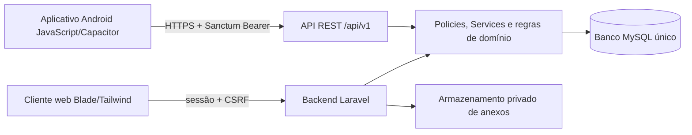

# Arquitetura

Web e Android são clientes independentes. Operações usam o mesmo backend, regras, policies e banco; a API não possui banco nem regras de negócio paralelos.

## Componentes

- `backend/`: Laravel 13, páginas Blade/Tailwind, API versionada, autenticação, autorização, workflow, SLA, auditoria, relatórios e persistência.
- `mobile/`: interface JavaScript própria, Vite e Capacitor 8, empacotada para Android. Não é um site remoto dentro de uma WebView.
- `docs/`: preparação, contratos e procedimentos operacionais.

## Domínio e relações centrais

As tabelas do domínio incluem usuários e funções/permissões, campi, prédios e locais, categorias, equipes e associações de membros, chamados, comentários, anexos, histórico de chamados, políticas/calendários SLA, notificações e avaliações. Chamado referencia solicitante, categoria e localização; pode ter equipe e técnico atribuídos. Comentários, anexos, avaliações e eventos de histórico pertencem ao chamado e têm autoria quando aplicável. Vínculos opcionais são validados no backend e protegidos por chaves estrangeiras; Policies e escopos limitam dados à função e campus.

Consulte migrations em `backend/database/migrations` e o contrato da API em `backend/docs/api-v1.md` para detalhes concretos. Não duplique essas regras no aplicativo.

## Fluxos de autenticação

- Web: sessão Laravel, cookies HttpOnly e proteção CSRF.
- Android: login pela API retorna token pessoal Sanctum; apenas o hash é persistido no servidor. O app armazena o token com AES/GCM e Android Keystore.
- O servidor aplica autorização em Policies/middleware. Ocultar controles no cliente não é controle de acesso.

## Arquivos privados

Anexos ficam no disco local privado `storage/app/private`; download requer autenticação e autorização do chamado. Não crie links públicos para anexos. Em produção, garanta armazenamento persistente incluído em backup. Uma instalação distribuída em múltiplos nós precisa de armazenamento compartilhado privado antes de escalar horizontalmente.
